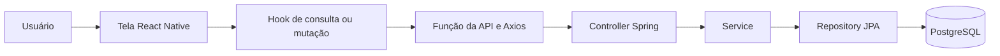
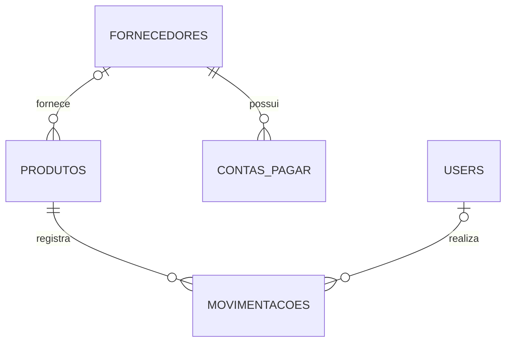

# InteliStock — guia de estudo do frontend e backend

Material baseado no código do projeto em 13/11/2026. O objetivo é entender o caminho
das operações e saber justificar as decisões em uma apresentação. O frontend recebe
mais atenção; a parte final descreve a API e o modelo de banco definido pelas entidades.

## Como estudar este guia

1. Entenda a visão geral e a organização das pastas.
2. Abra os arquivos citados enquanto lê as explicações do frontend.
3. Acompanhe os exemplos de login e saída de estoque, seguindo a ordem dos arquivos.
4. Estude as tabelas de endpoints e relacionamentos do backend.
5. Responda às perguntas finais sem consultar o texto; depois confira suas respostas.

Não é necessário decorar cada estilo. É mais importante explicar onde um dado nasce,
quem o valida, como chega ao servidor e por que a tela é atualizada depois da gravação.

## 1. Visão geral do sistema

O InteliStock gerencia produtos, fornecedores, movimentações de estoque e contas a pagar.
Também apresenta indicadores, consumo e sugestões de reposição.

Há três partes principais:

| Parte | Papel | Onde fica |
|---|---|---|
| Frontend | Interface, navegação, formulários, consultas e mensagens | `mobile/` |
| Backend | Autenticação, regras de negócio e acesso ao banco | `intellistock-backend/` |
| Banco | Persistência de usuários, fornecedores, produtos, movimentações e contas | PostgreSQL configurado pela API |

O frontend não acessa o PostgreSQL diretamente. Ele faz requisições HTTP e recebe JSON.
O backend verifica autenticação, valida os dados e executa as operações no banco.



Esse é o fluxo típico de estoque e contas. Login e cadastro utilizam funções da API
diretamente; o login também passa pelo contexto de autenticação.

**Frase para a apresentação:** “O aplicativo apresenta e coleta informações. A API
centraliza as regras e a persistência, permitindo que vários aparelhos usem a mesma base.”

## 2. Tecnologias do frontend e por que são usadas

| Tecnologia | Função neste projeto |
|---|---|
| React | Organiza a interface em componentes e atualiza a apresentação quando o estado muda |
| React Native | Fornece componentes como `View`, `TextInput`, `Pressable` e `FlatList` |
| Expo SDK 58 | Fornece ferramentas de desenvolvimento/empacotamento e módulos de fontes, armazenamento e notificações |
| TypeScript | Verifica tipos e contratos durante o desenvolvimento |
| React Navigation | Gerencia login/cadastro, abas e a pilha de telas da aba Mais |
| TanStack Query, também chamado React Query | Gerencia consultas, cache, mutações e invalidação de dados |
| Axios | Executa as requisições HTTP à API |
| Expo SecureStore | Persiste a sessão no armazenamento protegido do aparelho |
| Expo Notifications | Integra o aplicativo às notificações locais do sistema |
| React Native Web e React DOM | Permitem executar a interface no navegador |
| Safe Area Context | Adapta o conteúdo às áreas ocupadas por recortes e barras do aparelho |
| Ionicons e fontes Inter/Montserrat | Ícones e identidade visual |

As versões principais estão em [package.json](../mobile/package.json).
O arquivo `package-lock.json` registra as versões resolvidas das dependências para
que `npm ci` reproduza a instalação.

### TypeScript, TSX e JSX

- `.ts`: tipos, funções, configuração e lógica sem marcação de interface.
- `.tsx`: permite escrever JSX, a sintaxe de interface usada pelos componentes React.
- Um tipo como `Produto` descreve a estrutura esperada do objeto; não é uma tabela.
- Os tipos TypeScript não validam sozinhos o JSON recebido durante a execução.

O [tsconfig.json](../mobile/tsconfig.json) herda a configuração do Expo e ativa
checagem estrita, detecção de variáveis/imports e parâmetros sem uso. `noEmit` faz
o TypeScript verificar o código sem gerar JavaScript nessa etapa. O empacotamento
é feito pelas ferramentas do Expo/Metro.

## 3. Mapa completo do frontend

```text
mobile/
├── App.tsx                       entrada da aplicação
├── app.json                      nome, ícones, plataformas e plugins Expo
├── package.json                  bibliotecas e comandos
├── tsconfig.json                 configuração TypeScript
├── assets/brand/                 logo
├── tests/                        testes automatizados Node
└── src/
    ├── api/                      HTTP, funções de endpoints, contratos e erros
    ├── components/               componentes reutilizáveis e formulários
    ├── config/                   endereço e timeout da API
    ├── contexts/                 sessão e mensagens globais
    ├── hooks/                    consultas, mutações, cache e debounce
    ├── navigation/               rotas, tipos e URLs web
    ├── notifications/            planejamento e agendamento de lembretes
    ├── screens/                  telas completas
    ├── storage/                  persistência local da sessão
    ├── theme/                    cores, espaçamentos e fontes
    └── utils.ts                  busca, números e datas
```

### Diferença entre tela, componente e hook

Uma **tela** representa uma área navegável, como Produtos. Um **componente** é uma
parte reutilizável, como um botão ou formulário modal. Um **hook** encapsula um
comportamento React, como consultar produtos e acompanhar seu carregamento.

Separar essas funções evita que uma tela tenha de conhecer todos os detalhes do HTTP,
do cache e da identidade visual.

## 4. Inicialização: o que acontece ao abrir o aplicativo

Leia [App.tsx](../mobile/App.tsx).

1. `useFonts` inicia o carregamento das fontes.
2. Enquanto elas carregam, aparece uma tela de espera com logo e indicador.
3. Se as fontes falharem, o aplicativo pode continuar usando a fonte do sistema.
4. São montados os provedores compartilhados e o contêiner de navegação.
5. `AuthProvider` tenta restaurar a sessão local.
6. `RootNavigator` decide entre mostrar autenticação ou as abas do sistema.

| Elemento em `App.tsx` | Responsabilidade |
|---|---|
| `CustomFontsProvider` | Informa aos textos se as fontes personalizadas estão disponíveis |
| `AppErrorBoundary` | Apresenta uma tela alternativa para erros de renderização capturados pelo React |
| `QueryClientProvider` | Disponibiliza o cliente de cache e consultas |
| `SafeAreaProvider` | Disponibiliza as margens seguras do dispositivo |
| `AuthProvider` | Disponibiliza usuário, token e operações de entrada/saída |
| `ToastProvider` | Disponibiliza mensagens temporárias globais |
| `NavigationContainer` | Mantém o estado da navegação e integra as URLs web |
| `StatusBar` | Configura a aparência da barra de status |

Um **provider** oferece dados e funções aos componentes descendentes. A ordem tem
significado: `AuthProvider` utiliza o cliente do React Query e precisa estar dentro
de `QueryClientProvider`.

O `QueryClient` é criado fora da função `App`, para não ser recriado a cada renderização.
O projeto permite uma nova tentativa em consultas que falham (`retry: 1`) e desativa
a atualização automática apenas por foco da janela (`refetchOnWindowFocus: false`).

O Error Boundary não substitui os `try/catch` das requisições: falhas em operações
assíncronas e eventos precisam de tratamento próprio.

## 5. Navegação e proteção das telas

Arquivos: [RootNavigator.tsx](../mobile/src/navigation/RootNavigator.tsx),
[types.ts](../mobile/src/navigation/types.ts) e [linking.ts](../mobile/src/navigation/linking.ts).

```text
Enquanto restaura a sessão → carregamento
Sem token → Login → Cadastro
Com token → Dashboard | Produtos | Estoque | Contas | Mais
                                                   ├── Menu
                                                   ├── Fornecedores
                                                   └── Análises
```

- O **stack** mantém uma pilha de telas e permite voltar.
- As **abas** permitem alternar entre as áreas principais.
- `types.ts` define nomes de rotas e parâmetros aceitos. Por exemplo, Login pode
  receber o e-mail e a indicação de cadastro concluído.
- `linking.ts` mapeia rotas para endereços como `/produtos`, `/contas`,
  `/mais/fornecedores` e `/mais/analises`. Essa integração está ativada somente na web.
- Os cabeçalhos padrão da navegação ficam ocultos porque o projeto usa cabeçalhos próprios.

Ter um token no estado faz o frontend mostrar as áreas autenticadas. **Quem confirma
a validade do token e protege os dados é o backend.** Ocultar uma tela não seria
uma proteção suficiente para a API.

No modo autenticado também entram o monitoramento visual de estoque baixo e o
`DueReminderProvider`, responsável por coordenar os lembretes de contas.

## 6. Telas: o que faz cada arquivo

### LoginScreen.tsx

[Arquivo](../mobile/src/screens/LoginScreen.tsx). Mantém e-mail, senha, carregamento,
erro e mensagem de sucesso após cadastro. `handleLogin` verifica campos vazios,
chama `signIn` do contexto e trata falhas. A navegação muda quando o contexto passa
a ter token; não é a tela que precisa abrir manualmente cada aba.

### RegisterScreen.tsx

[Arquivo](../mobile/src/screens/RegisterScreen.tsx). Coleta nome, e-mail, senha,
confirmação e código de cadastro. Verifica preenchimento, tamanho mínimo da senha
e igualdade da confirmação. Chama a API e volta ao login com e-mail preenchido.
A confirmação da senha é uma verificação local e não é enviada no payload.
O cadastro não autentica automaticamente o usuário.

### DashboardScreen.tsx

[Arquivo](../mobile/src/screens/DashboardScreen.tsx). Usa `useDashboardQuery` e
apresenta indicadores de estoque e financeiro, sugestões de reposição, consumo
mensal, movimentos recentes e vencimentos próximos.

O gráfico de consumo é montado com componentes `View` e alturas proporcionais;
não há biblioteca externa de gráficos nessa implementação. Cada unidade de medida
tem uma série própria: litros e quilos não são somados no mesmo indicador de quantidade.
Os cálculos principais vêm da API; a tela formata e apresenta os resultados.

### ProdutosScreen.tsx

[Arquivo](../mobile/src/screens/ProdutosScreen.tsx). Lista produtos ativos, permite
buscar, cadastrar, editar e desativar. Usa `FlatList` para renderizar uma janela de
itens em vez de montar todos os cartões de uma vez. Isso não significa paginação
da API: a consulta atual recebe o catálogo completo de produtos ativos.

A busca é local. `useDebouncedValue` espera 300 ms sem nova alteração do texto;
`matchesSearch` normaliza o nome e a pesquisa. `useMemo` reaproveita o filtro enquanto
lista e pesquisa permanecerem iguais.

O estado de edição usa três situações:

| Valor | Significado |
|---|---|
| `undefined` | Formulário fechado |
| `null` | Formulário de novo produto |
| Objeto `Produto` | Formulário de edição daquele produto |

Desativar abre uma confirmação. A API preserva o produto e seu histórico, marcando-o
como inativo. O app não oferece atualmente todas as funções administrativas da API,
como reativação.

### EstoqueScreen.tsx

[Arquivo](../mobile/src/screens/EstoqueScreen.tsx). Exibe saldo, mínimo, valor em
estoque e filtros Todos/Baixo/Zerado. Abre `MovimentacaoModal` para entrada ou saída.
O histórico recente consulta e mostra até oito movimentos. Ao atualizar manualmente,
consulta novamente estoque e histórico.

O filtro visual não altera saldos. A movimentação efetiva depende da resposta da API.

### ContasScreen.tsx

[Arquivo](../mobile/src/screens/ContasScreen.tsx). Possui filtro por status, formulário
de conta e confirmações de pagar, cancelar, reabrir e excluir. A seleção do status
participa da consulta à API e da chave do cache.

Contas pendentes ou vencidas podem ser editadas e pagas/canceladas. Pagas ou canceladas
podem ser reabertas. Excluir é uma operação diferente de cancelar e é definitiva na API.

“Pagar” **registra o pagamento dentro do sistema**. Não envia dinheiro, não acessa
banco financeiro e não processa uma transação bancária.

A tela também exibe a situação dos avisos locais e oferece um teste que consulta
todas as contas, independentemente do filtro visível.

### MaisScreen.tsx, FornecedoresScreen.tsx e AnalisesScreen.tsx

- [MaisScreen](../mobile/src/screens/MaisScreen.tsx): menu de fornecedores e planejamento.
- [FornecedoresScreen](../mobile/src/screens/FornecedoresScreen.tsx): busca, cadastro,
  edição e exclusão de fornecedores. A pesquisa atual é enviada à API, diferentemente
  da pesquisa local de produtos.
- [AnalisesScreen](../mobile/src/screens/AnalisesScreen.tsx): consulta consumo e reposição,
  apresenta cartões e esconde produtos sem consumo da lista de indicadores de consumo.
  A sugestão pode existir mesmo sem saídas, baseada no mínimo cadastrado.

## 7. Componentes compartilhados e formulários

Todos ficam em `mobile/src/components/`.

| Arquivo | O que estudar |
|---|---|
| `Screen.tsx` | Área segura, largura máxima, espaçamento, rolagem e atualização manual; Produtos desativa a rolagem externa para usar FlatList |
| `Header.tsx` | Título, subtítulo, logo e confirmação de logout |
| `BackHeader.tsx` | Cabeçalho das subseções com ação de voltar |
| `BrandLogo.tsx` | Reutilização do asset da marca |
| `AppText.tsx` | Escolha de fonte conforme o peso e alternativa quando as fontes não carregam |
| `AppErrorBoundary.tsx` | Tratamento de falhas de renderização |
| `StateView.tsx` | Indicador de carregamento, mensagem de erro e nova tentativa |
| `EmptyState.tsx` | Explicação para listas vazias |
| `FeedbackBanner.tsx` | Mensagem local de sucesso ou erro |
| `KpiCard.tsx` | Cartão de indicador do dashboard |
| `ReposicaoCard.tsx` | Sugestão, custo, prioridade e detalhes expansíveis do cálculo |
| `ProductFormModal.tsx` | Cadastro e edição de produto |
| `MovimentacaoModal.tsx` | Quantidade, tipo e observação de entrada/saída |
| `FornecedorFormModal.tsx` | Cadastro e edição de fornecedor |
| `ContaFormModal.tsx` | Cadastro e edição de conta a pagar |
| `ui.tsx` | Botão, campo, cartão, selo, escolha, título de seção, modal e confirmação |

Em [ui.tsx](../mobile/src/components/ui.tsx):

- `Button` recebe título, ação, variante, estado desabilitado e carregamento.
- `TextField` acrescenta rótulo e erro ao `TextInput`.
- `Choice` representa opções como unidade de medida ou fornecedor.
- `StatusBadge` padroniza os selos de status e suas cores.
- `FormModal` reúne modal, rolagem, área segura e tratamento de teclado no iOS.
- `ConfirmationDialog` separa cancelar e confirmar uma ação.

**Props** são os dados e callbacks recebidos por um componente. Por exemplo,
`onSaved` permite ao formulário avisar a tela de que concluiu a gravação, sem o
formulário precisar conhecer todos os estados da tela.

### Como os formulários funcionam

1. Ao abrir, um `useEffect` preenche os campos com o registro ou limpa para um cadastro.
2. Os campos são controlados por `useState` e atualizados com `onChangeText`.
3. O envio converte e valida os valores.
4. Uma mutação chama a API.
5. Enquanto envia, controles e fechamento são bloqueados conforme o formulário.
6. Sucesso fecha o modal e avisa a tela; erro mantém o formulário com uma mensagem.

`ProductFormModal` aceita quantidade inicial somente no cadastro. Na edição,
alterar saldo depende de movimentações. Fornecedor é opcional no produto e obrigatório
na conta. Valores monetários aceitam duas casas; quantidades, três.

`useRef(false)` cria uma trava imediata para impedir dois envios antes que o React
atualize a interface. O estado de carregamento é usado para o feedback visual.
Essa trava não substitui transações e verificações do servidor.

## 8. Conceitos React presentes no código

| Recurso | Explicação | Exemplo do projeto |
|---|---|---|
| `useState` | Guarda um valor que influencia a interface; a atualização solicita nova renderização | Pesquisa, campos, modal aberto, filtro |
| `useEffect` | Sincroniza o componente com operações e eventos externos ao cálculo de renderização | Restaurar sessão, preencher formulário e observar AppState |
| `useRef` | Guarda um valor entre renderizações sem atualizar a tela por si só | Trava de envio, timer e estoque anterior |
| `useMemo` | Reaproveita um resultado enquanto as dependências não mudam | Produtos filtrados e valor de contexto |
| `useCallback` | Mantém a referência de uma função enquanto as dependências não mudam | `signOut` e funções de toast |
| `useContext` | Lê dados oferecidos por um provider | `useAuth` e `useToast` |
| Hook personalizado | Reutiliza comportamento que utiliza hooks | `useProdutosQuery`, `useDebouncedValue` |

Renderizar novamente significa recalcular a descrição da interface; não significa
recriar indiscriminadamente toda a tela nativa. Memoização é uma ferramenta pontual,
não uma garantia de que o componente nunca será renderizado de novo.

Outras construções importantes:

- `async/await`: permite aguardar uma requisição e tratar seu resultado em sequência.
- `try/catch/finally`: trata falha e restaura travas/carregamento ao terminar.
- `?.`: acessa uma propriedade quando o objeto existe, como `product.fornecedor?.nome`.
- `??`: utiliza alternativa quando o valor é `null` ou `undefined`.
- `map`: transforma dados em uma lista de componentes; `key` identifica cada item.
- `filter`: escolhe itens sem modificar a lista original.
- `import type`: importa somente um contrato TypeScript, sem dependência em execução.

## 9. Consultas, mutações e cache

Leia [useIntellistockQueries.ts](../mobile/src/hooks/useIntellistockQueries.ts) e
[queryInvalidation.ts](../mobile/src/hooks/queryInvalidation.ts).

Uma **query** lê dados. Uma **mutation** realiza uma operação de escrita ou mudança.
Neste projeto, as queries utilizam GET; as mutações chamam POST, PUT, PATCH ou DELETE.

| Hook de leitura | Dados |
|---|---|
| `useDashboardQuery` | Resumo do dashboard |
| `useProdutosQuery` | Produtos |
| `useEstoqueQuery` | Visão do estoque |
| `useContasQuery` | Contas, com status opcional |
| `useFornecedoresQuery` | Fornecedores, com pesquisa opcional |
| `useMovimentacoesQuery` | Movimentações, produto e limite opcionais |
| `useConsumoQuery` | Indicadores de consumo |
| `useReposicoesQuery` | Sugestões de reposição |

As mutações são agrupadas em `useProdutoMutations`, `useFornecedorMutations`,
`useContaMutations` e `useMovimentacaoMutation`.

Uma `queryKey` identifica dados no cache. Por exemplo, contas pagas e contas pendentes
possuem chaves distintas. Produto e limite também participam da chave do histórico.

`staleTime: 30_000` mantém o resultado considerado fresco durante 30 segundos.
**Não é um timer que consulta automaticamente a cada 30 segundos.** A atualização
depende de eventos como montagem de consulta stale, invalidação ou `refetch` explícito.

Quando uma mutação termina com sucesso, o projeto invalida os grupos afetados:

| Alteração | Consultas invalidadas |
|---|---|
| Produto/estoque | Produtos, estoque, dashboard, movimentações, reposições e consumo |
| Fornecedor | Fornecedores, produtos, contas, dashboard e reposições |
| Conta | Contas e dashboard |

Invalidar significa marcar os dados para atualização; consultas ativas normalmente
buscam de novo. O servidor continua sendo a fonte de verdade.

O código aguarda a resposta e invalida consultas. Não implementa uma atualização
otimista geral, em que o saldo seria antecipado localmente antes da confirmação.

`AbortSignal` é repassado das queries ao Axios para permitir cancelamento da requisição.

## 10. Comunicação HTTP e contratos

| Arquivo | Função |
|---|---|
| [config/env.ts](../mobile/src/config/env.ts) | URL da API e timeout de 15 segundos |
| [api/client.ts](../mobile/src/api/client.ts) | Instância Axios, token e tratamento global de 401 |
| [api/intellistock.ts](../mobile/src/api/intellistock.ts) | Funções que chamam os endpoints |
| [api/types.ts](../mobile/src/api/types.ts) | Tipos das respostas e payloads |
| [api/errors.ts](../mobile/src/api/errors.ts) | Tradução de erros de API/rede para mensagens |

`EXPO_PUBLIC_API_URL` é incorporada ao aplicativo. No computador o padrão é
`http://localhost:8080`; no celular, `localhost` aponta para o próprio aparelho,
por isso é necessário usar o endereço do computador que executa a API.
Variáveis `EXPO_PUBLIC_*` não devem carregar segredos: são públicas no bundle.

Um exemplo real de função de leitura é `getProdutos`. Ela faz GET em `/api/produtos`
e devolve `response.data`; as telas não precisam manipular o objeto HTTP completo.
`createProduto` envia um payload por POST. `updateProduto` envia PUT com o ID na URL.

Diferenças de contrato:

- **Parâmetro de caminho:** `/api/produtos/{id}` identifica um produto.
- **Query parameter:** `?status=PAGA` filtra a consulta.
- **Corpo JSON:** contém os campos enviados para cadastro ou edição.
- **Header:** `Authorization: Bearer <token>` identifica a sessão na API.

`ProdutoPayload` descreve a entrada. `Produto` descreve a resposta, que também
contém ID, saldo, estado e outros campos calculados/gerados pelo servidor.

`getApiErrorMessage` procura mensagens de validação por campo, mensagens gerais,
timeout e falha de rede. O aplicativo usa uma mensagem alternativa quando não
há detalhes adequados na resposta.

## 11. Sessão e logout

Leia [AuthContext.tsx](../mobile/src/contexts/AuthContext.tsx) e
[sessionStorage.ts](../mobile/src/storage/sessionStorage.ts).

O contexto oferece `user`, `token`, `loading`, `signIn` e `signOut`.

### Entrada

1. LoginScreen chama `signIn(email, senha)`.
2. A função chama `login` na API.
3. A API devolve token e usuário, sem a senha.
4. O aplicativo tenta persistir essa sessão.
5. Limpa o cache da sessão anterior e configura o token padrão do Axios.
6. Atualiza `user` e `token`; o navegador passa a mostrar as abas.

No celular a persistência usa SecureStore; na web usa `localStorage`. O formato
salvo contém token e usuário, não a senha. Se persistir falhar, o acesso pode
continuar em memória enquanto a aplicação estiver aberta.

### Saída

O cabeçalho primeiro abre uma confirmação. Ao confirmar, `signOut` remove o token
do Axios e do estado, limpa o cache e tenta apagar a sessão e os lembretes locais.
`Promise.allSettled` permite tratar essas limpezas sem impedir a saída se uma falhar.

O interceptor trata 401 somente quando a autorização da requisição que falhou
corresponde à autorização atual. Isso impede que uma resposta atrasada de uma
sessão antiga encerre um login novo.

As escritas e limpezas no armazenamento são serializadas para respeitar a ordem
das operações. Logout é local; não há endpoint de logout nem lista de revogação
individual de tokens nessa implementação.

## 12. Busca, apresentação visual e utilitários

### Busca com e sem acentos

Em [utils.ts](../mobile/src/utils.ts), `matchesSearch` aplica:

```ts
value.normalize("NFD").replace(/[\u0300-\u036f]/g, "").toLowerCase()
```

`normalize("NFD")` decompõe letras acentuadas; a expressão remove as marcas e
`toLowerCase` padroniza maiúsculas/minúsculas. A comparação usa `includes`, portanto
um trecho do nome também pode encontrar o produto. O nome original continua sendo exibido.
Exemplos: `cafe` encontra `Café torrado`; `acuc` encontra `Açúcar`.

### Números e datas

- `formatCurrency`: apresenta moeda em reais.
- `formatQuantity`: apresenta até três casas e unidade opcional.
- `parseDecimalInput`: aceita vírgula ou ponto decimal e recusa formatos como `1e3`.
- `formatDate`: apresenta datas no formato brasileiro.
- `formatDateInput`: ajuda a digitar DD/MM/AAAA.
- `parseDateInput` e `isValidIsoDate`: recusam datas impossíveis e convertem para a API.
- `todayIsoLocal`: obtém a data local no formato YYYY-MM-DD.

Os valores digitados ficam como texto até a conversão. Isso permite escrever uma
vírgula, deixar o campo vazio e apresentar erros antes de enviar um número à API.

### Tema e estilos

- `theme/colors.ts`: paleta de cores.
- `theme/tokens.ts`: espaçamentos, raios e sombras.
- `theme/typography.ts`: nomes das fontes e escolha conforme o peso.
- `StyleSheet.create`: agrupa estilos usados pelos componentes.
- Estilos em arrays combinam uma base com condições, como botão desabilitado.
- Flexbox controla alinhamento e distribuição dos elementos.
- `accessibilityLabel`, `accessibilityRole` e `accessibilityState` descrevem controles
  para tecnologias assistivas.

Reutilizar os tokens facilita mudar o visual de forma consistente.

## 13. Mensagens e notificações: três recursos diferentes

| Recurso | Onde está | Como funciona |
|---|---|---|
| Feedback da tela | `FeedbackBanner` e estados locais | Mostra resultado próximo da operação |
| Toast global | `ToastContext.tsx` | Mensagem temporária sobre a interface, com animação e timer |
| Notificação local | `notifications/` | Aviso agendado no sistema do aparelho |

Os alertas de estoque em `RootNavigator` são toasts. Os lembretes de contas são
notificações locais. Não existe servidor enviando push nessa implementação.

### Os três arquivos de lembretes

1. [dueReminderPlan.ts](../mobile/src/notifications/dueReminderPlan.ts): regra pura.
   Recebe contas e calcula avisos para 7 dias antes, 3 dias antes e o vencimento,
   às 9h do aparelho. Ignora marcos passados e contas pagas/canceladas; limita o
   plano aos próximos 60 avisos. Também monta o texto do teste.
2. [dueReminderScheduler.ts](../mobile/src/notifications/dueReminderScheduler.ts):
   usa Expo Notifications para consultar permissão, canal Android, agendar, cancelar
   e reconciliar o plano desejado com o que já está agendado.
3. [DueReminderProvider.tsx](../mobile/src/notifications/DueReminderProvider.tsx):
   coordena permissão, consulta de contas, mudanças dos dados e retorno do app ao primeiro plano.

Identificadores, assinaturas e datas evitam manter lembretes antigos quando uma
conta é editada. As operações do scheduler são serializadas. Um contador de geração
invalida solicitações de teste iniciadas antes do logout, inclusive quando a
consulta das contas termina depois da saída.

Avisos de teste têm uma origem própria: a reconciliação dos avisos automáticos não
os apaga, mas o logout cancela os dois tipos.

Na web esses avisos locais não são agendados. O sistema do celular pode atrasar
notificações; permissões e entrega real precisam ser verificadas em aparelho.
Alterações feitas em outro dispositivo dependem de uma nova consulta neste aplicativo.

## 14. Três fluxos para explicar de ponta a ponta

### A. Cadastrar um produto

```text
ProdutosScreen abre ProductFormModal
→ formulário valida e monta ProdutoPayload
→ useProdutoMutations().create.mutateAsync(payload)
→ createProduto faz POST /api/produtos
→ ProdutoController valida o DTO
→ ProdutoService grava produto e entrada inicial, se houver
→ resposta retorna ao formulário
→ hook invalida consultas relacionadas
→ formulário fecha e a tela apresenta sucesso
```

**Por que invalidar mais que Produtos?** Porque um produto e seu estoque também
alteram dashboard, reposição, consumo e histórico de movimentações.

### B. Registrar uma saída

```text
EstoqueScreen seleciona produto e abre MovimentacaoModal
→ usuário informa quantidade e observação
→ useMovimentacaoMutation
→ createMovimentacao faz POST /api/movimentacoes
→ API autentica e valida
→ serviço bloqueia a linha do produto e confere saldo atual
→ atualiza saldo e grava movimentação na mesma transação
→ retorna saldoResultante
→ aplicativo exibe o saldo confirmado e atualiza consultas
```

A interface mostra o saldo conhecido, mas outro aparelho pode alterá-lo antes do envio.
Por isso a conferência final precisa ocorrer no backend, dentro da transação.
Se ocorrer timeout, a gravação pode ter sido concluída mesmo sem resposta ao aparelho.
A trava local não garante idempotência: confira o histórico antes de reenviar.

### C. Registrar pagamento de conta

```text
ContasScreen abre ConfirmationDialog
→ usuário confirma
→ useContaMutations().pay
→ PATCH /api/contas/{id}/pagar
→ serviço confere estado e registra PAGA/dataPagamento
→ invalida contas e dashboard
→ tela atualiza a situação; provider reconcilia os lembretes
```

O botão registra uma informação interna. Não há integração de pagamento bancário.

## 15. Backend: organização e responsabilidades

O código Java está em
`intellistock-backend/src/main/java/br/com/intellistock/intellistock_backend/`.
O arquivo `IntellistockBackendApplication.java` inicia a aplicação Spring Boot.

| Pasta | Função | Exemplos |
|---|---|---|
| `controller` | Recebe HTTP, parâmetros e corpo; delega ao serviço | ProdutoController, ContaPagarController, AnaliseController |
| `service` | Aplica regras e coordena transações | ProdutoService, MovimentacaoService, ContaPagarService, AnaliseService |
| `repository` | Acesso aos dados por Spring Data JPA e consultas próprias | ProdutoRepository, MovimentacaoRepository |
| `entity` | Mapeia tabelas e relacionamentos | Produto, Fornecedor, ContaPagar, Movimentacao, User |
| `dto` | Define entradas e saídas da API | ProdutoRequest, ProdutoResponse, ErrorResponse |
| `security` | Gera/valida JWT e autentica as requisições | JwtService, JwtAuthenticationFilter, JsonSecurityErrorHandler |
| `config` | Configura segurança, relógio e parâmetros | SecurityConfig, ClockConfig, AnaliseProperties |
| `exception` | Exceções e tradução para respostas HTTP | BusinessException, ConflictException, GlobalExceptionHandler |
| `util` | Regra utilitária específica | CnpjUtils |

Os nove controllers são Auth, User, Produto, Fornecedor, Estoque, Movimentacao,
ContaPagar, Analise e Dashboard. Os nove services correspondem a esses grupos;
`CalculoReposicao` é um cálculo puro adicional, sem acesso ao banco.

### Anotações importantes

- `@RestController`: registra uma classe que atende HTTP e devolve respostas serializadas.
- `@RequestMapping`: define o prefixo de rota.
- `@GetMapping`, `@PostMapping`, etc.: ligam verbo/caminho a um método.
- `@RequestBody`: recebe o JSON do corpo; `@RequestParam`: recebe filtro da URL.
- `@PathVariable`: recebe o ID que faz parte do caminho.
- `@Valid`, `@NotBlank`, `@NotNull`, `@Digits`, `@Size`: acionam/restringem a validação.
- `@Service`: registra o serviço para injeção de dependências.
- `@Transactional`: executa operações em uma transação; falhas previstas pelo
  mecanismo transacional podem provocar rollback.
- `@Entity`, `@Table`, `@Id`, `@Column`: mapeiam classe, tabela, chave e colunas.
- `@ManyToOne` e `@JoinColumn`: mapeiam referências entre entidades.
- `@Version`: adiciona controle de concorrência otimista ao produto.
- `@ConfigurationProperties` e `@Validated`: carregam e validam parâmetros de configuração.

O Spring injeta dependências pelos construtores. Um repository é uma interface;
o Spring Data fornece sua implementação em execução. JPA é a especificação de
persistência utilizada; Hibernate é a implementação presente no projeto.

Um DTO de resposta não precisa ter os mesmos campos de uma entidade. Por exemplo,
`UserResponse` não expõe o hash da senha, e `EstoqueResponse` contém informações
calculadas para a tela. Records Java são usados para diversos contratos de dados.

## 16. Autenticação e segurança no backend

1. Cadastro recebe nome, e-mail, senha e código compartilhado.
2. `AuthService` verifica o código configurado em `CODIGO_CADASTRO`.
3. `UserService` confere o cadastro e grava o hash BCrypt da senha.
4. Login utiliza `AuthenticationManager` para verificar as credenciais.
5. `JwtService` devolve um token assinado com HS256, contendo ID, e-mail e datas.
6. Nas requisições seguintes, o filtro lê `Authorization: Bearer <token>`.
7. Confere assinatura e expiração, busca o usuário e configura a autenticação.

O token contém `sub` (ID do usuário), `email`, `iat` (emissão) e `exp` (expiração).
O prazo padrão é 120 minutos. O segredo JWT precisa de ao menos 32 bytes.

**Assinatura não é criptografia do conteúdo.** O JWT não deve ser descrito como
uma forma de esconder informações sensíveis. A senha fica protegida por hash,
não por um processo reversível de armazenamento de texto.

A API utiliza autenticação stateless, sem manter uma HttpSession de login.
Não há refresh token nem endpoint de logout. O acesso aos dados continua protegido
pela API mesmo que alguém tente chamar endpoints sem usar a interface.

Cadastro/login dispensam JWT, mas cadastro ainda exige código válido. Os demais
endpoints de negócio exigem autenticação. Todos os usuários autenticados compartilham
a base e têm as mesmas permissões; não há isolamento por empresa ou perfil de cargo.

## 17. Todos os endpoints da API

São **32 endpoints de negócio**. A base local padrão é `http://localhost:8080`.
`{id}` e `{produtoId}` representam UUIDs. Listas de filtros significam query parameters
opcionais, salvo indicação diferente. Não confunda as rotas web de telas com estes endpoints.

### Autenticação e usuário — 3 endpoints

| Método e caminho | Entrada | Resposta de sucesso |
|---|---|---|
| `POST /api/auth/register` | JSON: nome, email, senha, codigoAcesso | 201: usuário sem senha |
| `POST /api/auth/login` | JSON: email, senha | 200: token, tokenType e usuário |
| `GET /api/users/me` | JWT no header | 200: usuário atual |

Cadastro valida nome até 120 caracteres, e-mail até 180, senha de 8 a 72 caracteres
e código até 128. A senha também deve respeitar o limite de 72 bytes UTF-8 do BCrypt;
caracteres acentuados podem ocupar mais de um byte.

### Produtos — 6 endpoints

| Método e caminho | Entrada | Resposta de sucesso |
|---|---|---|
| `GET /api/produtos` | busca, fornecedorId, incluirInativos=false | 200: lista |
| `GET /api/produtos/{id}` | ID | 200: produto |
| `POST /api/produtos` | ProdutoRequest | 201: produto criado |
| `PUT /api/produtos/{id}` | ID e ProdutoRequest | 200: produto atualizado |
| `DELETE /api/produtos/{id}` | ID | 204: produto desativado |
| `PATCH /api/produtos/{id}/reativar` | ID | 200: produto reativado |

Corpo de produto: `nome`, `descricao` opcional, `quantidadeInicial` opcional,
`estoqueMinimo`, `unidadeMedida`, `preco` e `fornecedorId` opcional.
Nome até 150 caracteres e descrição até 500; quantidades não negativas com três
casas; preço não negativo com duas. Depois de haver movimentação, a unidade não
pode ser alterada. Na atualização, quantidade inicial é ignorada.

### Fornecedores — 5 endpoints

| Método e caminho | Entrada | Resposta de sucesso |
|---|---|---|
| `GET /api/fornecedores` | busca | 200: lista |
| `GET /api/fornecedores/{id}` | ID | 200: fornecedor |
| `POST /api/fornecedores` | nome, cnpj, telefone, email | 201: fornecedor criado |
| `PUT /api/fornecedores/{id}` | ID e mesmos campos | 200: atualizado |
| `DELETE /api/fornecedores/{id}` | ID | 204: excluído |

Somente nome é obrigatório. CNPJ, quando informado, é normalizado, validado e deve
ser único. Fornecedores com produtos ou contas vinculados não podem ser excluídos.

### Estoque — 3 endpoints

| Método e caminho | Entrada | Resposta de sucesso |
|---|---|---|
| `GET /api/estoque` | Sem filtros | 200: posição dos produtos ativos |
| `GET /api/estoque/baixo` | Sem filtros | 200: ativos com quantidade menor/igual ao mínimo |
| `GET /api/estoque/{produtoId}` | ID do produto | 200: posição do produto |

A resposta contém produtoId, produtoNome, unidadeMedida, quantidade, estoqueMinimo,
situacao e valorEmEstoque. Situação é ZERADO quando quantidade é zero, BAIXO quando
positiva e menor/igual ao mínimo, NORMAL quando acima. Valor = quantidade × preço.

### Movimentações — 3 endpoints

| Método e caminho | Entrada | Resposta de sucesso |
|---|---|---|
| `GET /api/movimentacoes` | produtoId, tipo, inicio, fim, limite=100 | 200: lista recente |
| `GET /api/movimentacoes/{id}` | ID | 200: movimentação |
| `POST /api/movimentacoes` | produtoId, tipo, quantidade, data opcional, observacao opcional | 201: movimento e saldo resultante |

`tipo` aceita ENTRADA ou SAIDA. Quantidade precisa ser positiva, com até três casas.
`inicio` e `fim` usam YYYY-MM-DD; limite aceita 1 a 1000. A data de um lançamento,
quando informada, inclui horário/fuso e não pode estar no futuro; omitida, usa agora.
O app atual não oferece campo de data retroativa, embora a API aceite esse uso.

### Contas — 8 endpoints

| Método e caminho | Entrada | Resposta de sucesso |
|---|---|---|
| `GET /api/contas` | status, fornecedorId, vencimentoInicio, vencimentoFim | 200: lista |
| `GET /api/contas/{id}` | ID | 200: conta |
| `POST /api/contas` | ContaPagarRequest | 201: conta criada |
| `PUT /api/contas/{id}` | ID e ContaPagarRequest | 200: conta atualizada |
| `DELETE /api/contas/{id}` | ID | 204: conta excluída |
| `PATCH /api/contas/{id}/pagar` | Corpo opcional com dataPagamento | 200: conta paga |
| `PATCH /api/contas/{id}/cancelar` | ID | 200: conta cancelada |
| `PATCH /api/contas/{id}/reabrir` | ID | 200: conta reaberta |

Corpo de conta: `fornecedorId`, `descricao`, `valor`, `dataVencimento` e `observacao`
opcional. Descrição até 255; observação até 500; valor positivo com duas casas.
Datas de vencimento e pagamento usam YYYY-MM-DD. Vencimento pode ser passado;
pagamento não pode estar no futuro. Sem data de pagamento, usa hoje.

`PENDENTE` no filtro significa aberta ainda não vencida; `VENCIDA` significa aberta
com vencimento passado. Editar/pagar/cancelar exige conta aberta. Reabrir uma paga
ou cancelada retorna ao estado pendente e limpa a data de pagamento.

### Análises — 3 endpoints

| Método e caminho | Entrada | Resposta de sucesso |
|---|---|---|
| `GET /api/analises/consumo` | produtoId, dias entre 1 e 365 | 200: consumo por produto |
| `GET /api/analises/consumo/serie` | produtoId OU unidadeMedida; agrupamento; dias entre 1 e 730 | 200: série temporal |
| `GET /api/analises/reposicao` | dias, diasCobertura, prazoEntregaDias, diasSeguranca, todos=false | 200: sugestões |

Na série é necessário exatamente um de produtoId ou unidadeMedida. Agrupamento
padrão: DIARIO; também existem SEMANAL e MENSAL. Sem dias usa 30, 84 ou 180,
respectivamente. Sem produto no consumo, a resposta considera todos os ativos.

Na reposição, dias e cobertura aceitam 1–365; entrega e segurança, 0–365.
`todos=true` permite inspecionar o cálculo de todos os ativos, mesmo sem necessidade
de compra. O app usa as consultas padrão de consumo e reposição.

### Dashboard — 1 endpoint

| Método e caminho | Entrada | Resposta de sucesso |
|---|---|---|
| `GET /api/dashboard` | diasVencimento=7, entre 0 e 90 | 200: indicadores e listas agregadas |

Inclui estoque, financeiro, contagem de sugestões, dez movimentos recentes,
contas próximas do vencimento e seis meses de consumo separado por unidade.
A interface exibe apenas cinco movimentos e três vencimentos no dashboard.

### Exemplo de JSON de produto

```json
{
  "nome": "Café em grãos",
  "descricao": "Pacote para reposição",
  "quantidadeInicial": 20,
  "estoqueMinimo": 10,
  "unidadeMedida": "PCT",
  "preco": 25.50
}
```

Fornecedor é opcional nesse cadastro. Para associar um, acrescente `fornecedorId`
com um UUID existente. Não confunda o JSON de cadastro com a resposta: ID e campos
gerados pelo servidor aparecem depois da gravação.

### Erros HTTP importantes

| Código | Significado no projeto |
|---|---|
| 400 | JSON, campos ou parâmetros inválidos |
| 401 | Credenciais ou autenticação inválidas |
| 403 | Código de cadastro inválido ou acesso negado |
| 404 | Registro/endpoint não encontrado |
| 409 | Conflito de unicidade, vínculo ou concorrência |
| 422 | Regra de negócio, como saldo insuficiente |
| 405 / 406 / 415 | Verbo, formato de resposta ou conteúdo incompatível |
| 500 | Falha inesperada |

`GlobalExceptionHandler` e `JsonSecurityErrorHandler` padronizam as respostas.
`ErrorResponse` possui timestamp, status, error, message, path e erros de campos
quando aplicável. O frontend transforma esses dados em mensagens compreensíveis.

## 18. Banco de dados: tabelas, campos e relacionamentos

Esta seção descreve o mapeamento JPA do código. Não é uma inspeção dos dados
existentes no PostgreSQL do computador.

| Tabela | Entidade | Principais campos |
|---|---|---|
| `users` | User | id, nome, email único, senha com hash, createdAt |
| `fornecedores` | Fornecedor | id, nome, cnpj único/opcional, telefone, email, createdAt |
| `produtos` | Produto | id, nome, descricao, quantidade, estoqueMinimo, unidadeMedida, preco, fornecedor_id opcional, ativo, version, createdAt, updatedAt |
| `movimentacoes` | Movimentacao | id, produto_id, tipo, quantidade, saldoResultante, data, observacao, usuario_id opcional |
| `contas_pagar` | ContaPagar | id, fornecedor_id, descricao, valor, dataVencimento, dataPagamento, status, observacao, createdAt, updatedAt |

Os nomes apresentados misturam os nomes das propriedades Java com os nomes explícitos
de chaves estrangeiras; no banco o Hibernate aplica a convenção de nomes das colunas.



- Um fornecedor pode estar ligado a vários produtos e várias contas.
- Produto pode não ter fornecedor; uma conta precisa de fornecedor.
- Cada movimentação pertence a um produto; o usuário associado é opcional no modelo.
- IDs são UUIDs; referências usam chaves estrangeiras.
- Quantidades, mínimos e saldos resultantes usam precisão `numeric(15,3)`.
- Preços e valores de conta usam `numeric(15,2)`.
- Há índices em movimentações por produto/data e tipo/data; contas por status e vencimento.

**Não existe tabela separada de estoque, dashboard, análise ou reposição.** Estoque
utiliza o saldo de produtos. Dashboard e análises são resultados de consultas/cálculos.

O banco guarda os estados de contas controlados pelo serviço como PENDENTE, PAGA
e CANCELADA. VENCIDA é um estado efetivo calculado: pendente com vencimento anterior
a hoje. Não depende de um job diário que atualize todas as linhas.

### Integridade e concorrência

Movimentações bloqueiam a linha do produto dentro da transação. Atualizar saldo e
gravar histórico é uma unidade: se uma regra falhar, não deve ficar uma metade gravada.
Operações da mesma conta também utilizam bloqueio. Produto possui ainda `@Version`.

Esses mecanismos protegem contra concorrência no servidor. A trava de botão do
frontend resolve outro problema: repetição imediata do clique naquele aparelho.

Não existe chave de idempotência persistida para movimentações. Se a conexão cair
depois da gravação, reenviar pode duplicar um lançamento; é necessário conferir o histórico.

Lançamentos retroativos usam o saldo após o registro atual. O sistema não recalcula
automaticamente todos os saldos históricos em ordem cronológica.

### Configuração do banco

Em `src/main/resources/application.properties`, a API lê `DB_URL`, `DB_USERNAME`
e `DB_PASSWORD`. O perfil padrão usa validação do schema (`validate`); o perfil
de desenvolvimento usa atualização pelo Hibernate (`update`). Não há migrações
versionadas no projeto atual.

`.env.example.ps1` é o modelo; `.env.local.ps1` contém a configuração local carregada
pelo script PowerShell. O arquivo local é ignorado pelo Git. O frontend recebe
somente o endereço HTTP da API, não a senha do PostgreSQL.

Nos testes Java, a configuração troca PostgreSQL por H2 em memória e cria/remove
o schema de teste. Isso não equivale a testar o banco real.

## 19. Cálculos de consumo e reposição

`AnaliseService` consulta dados e coordena respostas. `CalculoReposicao` contém a
fórmula pura usada tanto na sugestão detalhada quanto na contagem do dashboard.

Consumo considera somente SAIDAS. A janela padrão é 30 dias:

```text
média diária = total de saídas / dias
média semanal = média diária × 7
média mensal = média diária × 30
```

A tendência compara médias das metades antiga e recente da janela. O limiar padrão
é 10%: variação maior/igual a 10% indica ALTA; menor/igual a -10%, BAIXA; demais,
ESTAVEL. Sem consumo antigo e com consumo recente, é ALTA sem percentual calculável.
Sem saídas nas duas metades, ou numa janela de um dia, é ESTAVEL nessa implementação.

```text
base = média diária
       ou max(média diária, média recente), se tendência ALTA

segurança = max(mínimo cadastrado, base × dias de segurança)
ponto de pedido = base × prazo de entrega + segurança
necessidade = max(base × (cobertura + entrega) + segurança − saldo, 0)
precisa repor = saldo ≤ ponto de pedido E necessidade > 0
```

Padrões: cobertura de 30 dias, entrega de 7 e segurança de 7.
Exemplo estável: média de 2 UN/dia, mínimo 10, saldo 20. Segurança é 14, ponto de
pedido é 28 e sugestão é `2 × 37 + 14 − 20 = 68 UN`.

A quantidade sugerida é arredondada para cima: inteira para UN/CX/PCT/FD, três casas
para KG/G/L/ML/M. Custo estimado = quantidade sugerida × preço cadastrado.
Prioridade alta indica saldo zero ou duração menor/igual ao prazo de entrega;
média indica saldo dentro da segurança; baixa indica os demais casos de reposição.

**É uma estimativa por fórmula, não inteligência artificial.** Não reconhece
sazonalidade nem dispara compra. O usuário deve avaliar o histórico e a situação real.

## 20. Testes e comandos para explicar

| Comando | O que verifica |
|---|---|
| `npm run typecheck`, dentro de mobile | Tipos e configuração TypeScript |
| `npm test`, dentro de mobile | Testes Node das regras e integrações simuladas |
| `npx expo-doctor`, dentro de mobile | Compatibilidade/configuração Expo |
| `npx expo export --platform all --output-dir dist` | Empacotamento Android, iOS e web |
| `.\mvnw.cmd test`, dentro do backend | Testes Java, incluindo HTTP com MockMvc e banco H2 |

Testes frontend: `utils.test.mjs`, `apiClient.test.mjs`, `queryInvalidation.test.mjs`,
`dueReminderPlan.test.mjs`, `dueReminderScheduler.test.mjs` e `navigation.test.mjs`.
Cobrem busca/datas/decimais, respostas 401, cache, planejamento/cancelamento de avisos
e configuração de navegação. APIs nativas são simuladas nos testes Node; isso não
comprova a entrega de notificação pelo sistema do aparelho.

Testes Java cobrem autenticação, DTOs, configurações, cálculos, contas, estoque e
concorrência em ambiente controlado. Na última validação desta revisão passaram
22 testes do aplicativo e 65 testes Java. Esses números são uma fotografia da revisão.

Typecheck, testes e empacotamento complementam o teste manual. Ainda é necessário
conferir toque, teclado, rolagem, rede e notificações no aparelho, além do PostgreSQL.

## 21. Perguntas prováveis do professor e respostas

### “Por que usar React Native com Expo?”

“Porque o projeto reutiliza a interface e a lógica entre Android, iOS e web, e o
Expo fornece as integrações de fontes, sessão segura e notificações usadas aqui.”

### “Qual a diferença entre componente, tela e hook?”

“Tela corresponde a uma rota; componente é uma peça de interface; hook encapsula
um comportamento React. Por exemplo: ProdutosScreen, ProductFormModal e useProdutosQuery.”

### “Por que React Query se já existe useState?”

“useState guarda estado local, como texto e modal. React Query coordena os dados
do servidor, seu cache, carregamento, erros e atualização após gravações.”

### “A consulta roda a cada 30 segundos?”

“Não. staleTime de 30 segundos define por quanto tempo o dado é considerado fresco.
Não existe polling periódico configurado por esse valor.”

### “Por que validar no frontend e no backend?”

“A validação local orienta o usuário. A validação do servidor protege a integridade
mesmo com outros clientes, requisições diretas ou alterações concorrentes.”

### “Como evita clicar duas vezes em Salvar?”

“Uma ref funciona como trava síncrona, e o estado de carregamento desabilita controles.
No servidor, transações e bloqueios tratam a concorrência entre operações.”

### “Como Café é encontrado ao pesquisar cafe?”

“A pesquisa de produtos decompõe o texto, remove as marcas de acento, padroniza
maiúsculas/minúsculas e compara trechos. O nome salvo não é alterado.”

### “Por que FlatList?”

“Para renderizar uma janela de itens e reduzir a montagem de componentes. Hoje a
consulta ainda traz o catálogo completo; virtualização e paginação são diferentes.”

### “Onde fica a senha do usuário no aplicativo?”

“A senha é usada no login, mas não é persistida na sessão. O aplicativo salva token
e usuário. No servidor, a senha está representada por hash BCrypt.”

### “O token está criptografado?”

“O JWT está assinado para validar sua integridade. O conteúdo não deve ser tratado
como secreto por causa da assinatura.”

### “Como uma saída atualiza outras telas?”

“Depois da confirmação da API, o hook invalida produtos, estoque, dashboard,
movimentações e análises. As consultas ativas buscam resultados atualizados.”

### “Por que o saldo é conferido de novo no servidor?”

“Porque outro aparelho pode movimentar o produto depois da leitura da tela.
A verificação definitiva ocorre com o produto bloqueado na transação.”

### “Existe tabela de estoque?”

“Não. O saldo está em produtos, e o histórico em movimentações. A resposta de estoque
é uma visão desses dados.”

### “O que acontece ao excluir um produto?”

“Ele é desativado para preservar o histórico. Fornecedor e conta têm regras de
exclusão diferentes; não são todos apagados da mesma forma.”

### “Como uma conta fica vencida?”

“A API calcula o status efetivo a partir de uma pendente com vencimento anterior
ao dia atual. Não precisa de uma rotina diária alterando todas as contas.”

### “Pagar a conta movimenta dinheiro?”

“Não. Registra a quitação no sistema, sem integração bancária.”

### “A reposição usa IA?”

“Não. Usa médias, tendência, prazo de entrega, cobertura e segurança em uma fórmula.
O card apresenta os resultados calculados pela API.”

### “As notificações vêm do backend?”

“Não. São locais, agendadas pelo aplicativo no aparelho. Mudanças de outro dispositivo
só entram no plano depois de atualizar os dados.”

### “Qual é a diferença entre toast e notificação?”

“Toast é uma mensagem dentro da interface. Notificação é um aviso do sistema do
aparelho, que pode aparecer com o aplicativo fechado.”

### “O aplicativo funciona totalmente offline?”

“Não. Há sessão persistida e cache em memória, mas não há banco local do catálogo
nem fila de gravações para sincronizar depois.”

### “Há atualização em tempo real entre aparelhos?”

“Não há websocket ou sincronização instantânea. Os dados mudam por novas consultas,
invalidações, atualização manual e eventos específicos do ciclo de vida.”

### “Cada usuário tem seu próprio estoque?”

“Não. Todos os autenticados compartilham os dados daquela instalação.”

### “O frontend usa todos os endpoints?”

“Não. A API também oferece consulta individual, reativação e séries filtradas que
não possuem necessariamente uma ação equivalente na interface atual.”

### “Os testes provam que tudo funciona?”

“Eles verificam regras e fluxos em condições controladas. Layout, entrega de avisos,
rede do celular e PostgreSQL ainda precisam de validação específica.”

### “Onde aparecem SOLID e reutilização?”

“A interface fica nas telas/componentes; acesso HTTP no cliente de API; cache nos hooks;
sessão no contexto; cálculo de reposição na API. A divisão reduz motivos distintos
de mudança no mesmo arquivo, sem criar uma interface para cada classe.”

## 22. Roteiro de apresentação e revisão final

### Apresentação curta do frontend

“O frontend do InteliStock foi construído com React Native, Expo e TypeScript. A
entrada é App.tsx, que carrega fontes e provedores. O navegador mostra login ou
as abas conforme a sessão. As telas utilizam componentes compartilhados e hooks
React Query. Esses hooks chamam funções HTTP centralizadas com Axios. Quando uma
operação termina, invalidamos as consultas afetadas para exibir o estado confirmado
pelo servidor. A senha não é salva no aparelho; persistimos token e usuário. As
notificações de contas são locais e têm planejamento separado do agendamento.”

### Apresentação curta do backend

“A API usa Java com Spring Boot, organizada em controllers, services, repositories,
entidades e DTOs. O JWT autentica as requisições. Services aplicam as regras e as
transações, repositories acessam PostgreSQL via JPA/Hibernate. O estoque fica no
produto e seu histórico nas movimentações. Os cálculos de consumo/reposição usam
saídas históricas. O sistema oferece 32 endpoints de negócio.”

### Ordem dos arquivos para revisar antes da apresentação

1. `mobile/App.tsx`.
2. `navigation/RootNavigator.tsx`, `types.ts`, `linking.ts`.
3. `screens/ProdutosScreen.tsx` e `components/ProductFormModal.tsx`.
4. `hooks/useIntellistockQueries.ts` e `queryInvalidation.ts`.
5. `api/intellistock.ts`, `client.ts`, `types.ts`, `errors.ts`.
6. `contexts/AuthContext.tsx` e `storage/sessionStorage.ts`.
7. `screens/EstoqueScreen.tsx` e `components/MovimentacaoModal.tsx`.
8. `screens/ContasScreen.tsx`, fornecedores e análises.
9. `notifications/` e componentes compartilhados.
10. `MovimentacaoController`, `MovimentacaoService`, repositories e entidades Java.

### Exercício para verificar se entendeu

Sem consultar o código, explique uma saída de estoque desde o clique até a
atualização do dashboard. Depois localize cada etapa nos arquivos. Se conseguir
explicar estado local, mutação, HTTP, token, validação, transação, banco e invalidação
nesse único fluxo, você terá uma boa base para responder às perguntas sobre o projeto.

