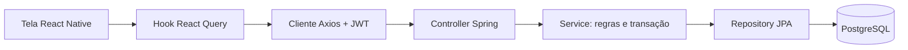

# Como explicar o InteliStock

O InteliStock controla produtos, fornecedores, entradas e saídas de estoque e contas a pagar.
Ele também calcula consumo e sugere reposição com fórmulas sobre o histórico de saídas.
Não há modelo de inteligência artificial nem compra automática.

## Caminho de uma operação



O aplicativo roda com React Native e Expo em Android, iOS e web. O mesmo código de tela
chama uma API HTTP em Java. Só a API acessa o banco. As respostas são JSON e os tipos
TypeScript descrevem os contratos usados pelas telas. O diagrama mostra o caminho das
consultas e mutações de estoque; login e cadastro chamam as funções da API diretamente.

## Por onde começar a leitura

| Parte | Arquivos principais | Responsabilidade |
| --- | --- | --- |
| Inicialização | `mobile/App.tsx` | Carrega fontes e instala os provedores de sessão, cache, área segura e mensagens. |
| Navegação | `mobile/src/navigation/RootNavigator.tsx` | Mostra login ou as cinco abas, conforme a sessão. |
| Interface | `mobile/src/screens/` e `components/` | Exibe dados, coleta campos e apresenta carregamento, sucesso ou erro. |
| Consultas | `mobile/src/hooks/useIntellistockQueries.ts` | Consulta/cacheia dados e invalida consultas afetadas após uma gravação. |
| Atualização de dados | `mobile/src/hooks/queryInvalidation.ts` | Agrupa as consultas que devem ser atualizadas quando estoque, fornecedor ou conta mudam. |
| HTTP | `mobile/src/api/client.ts` e `intellistock.ts` | Configura endereço/timeout/token e chama os endpoints. |
| Sessão | `AuthContext.tsx` e `storage/sessionStorage.ts` | Faz login/logout e restaura a sessão persistida. |
| Lembretes | `mobile/src/notifications/` | Planeja e agenda notificações locais de contas. |
| Entrada da API | `intellistock-backend/src/main/java/br/com/intellistock/intellistock_backend/` | Contém controllers, services, repositories, entidades e DTOs. |

No backend, uma **entity** representa uma tabela e seus relacionamentos. Um **DTO**
define os campos de entrada ou saída de um endpoint. O **controller** recebe a requisição,
o **service** decide o que é permitido e o **repository** consulta ou grava os dados.
O Spring injeta essas dependências pelos construtores. O JPA/Hibernate transforma as
operações com entidades em SQL.

Para estudar uma operação antes da apresentação, leiam estes arquivos nesta ordem:

1. [EstoqueScreen.tsx](../mobile/src/screens/EstoqueScreen.tsx): abre o formulário de movimentação.
2. [MovimentacaoModal.tsx](../mobile/src/components/MovimentacaoModal.tsx): coleta e valida a quantidade.
3. [useIntellistockQueries.ts](../mobile/src/hooks/useIntellistockQueries.ts): executa a mutação e atualiza consultas relacionadas.
4. [intellistock.ts](../mobile/src/api/intellistock.ts): envia o pedido HTTP à API.
5. [MovimentacaoController.java](../intellistock-backend/src/main/java/br/com/intellistock/intellistock_backend/controller/MovimentacaoController.java): recebe e valida o pedido.
6. [MovimentacaoService.java](../intellistock-backend/src/main/java/br/com/intellistock/intellistock_backend/service/MovimentacaoService.java): confere e altera o saldo.
7. [MovimentacaoRepository.java](../intellistock-backend/src/main/java/br/com/intellistock/intellistock_backend/repository/MovimentacaoRepository.java): oferece acesso aos registros de movimentação.

## Exemplo completo: registrar uma saída

1. `EstoqueScreen` abre `MovimentacaoModal` com o produto selecionado.
2. O modal mostra a unidade e o saldo e valida a quantidade informada. Uma trava impede dois envios simultâneos.
3. `useMovimentacaoMutation` chama `createMovimentacao`, que envia `POST /api/movimentacoes`.
4. O filtro JWT autentica a requisição; `MovimentacaoController` valida o DTO.
5. `MovimentacaoService` abre uma transação e bloqueia a linha do produto durante a alteração.
6. O serviço verifica produto ativo e saldo suficiente, altera a quantidade e grava a movimentação.
7. Se uma regra falhar, a transação é desfeita; saldo e histórico não ficam parcialmente gravados.
8. A resposta contém o saldo confirmado. O React Query invalida estoque, produtos, histórico,
   dashboard e análises; as telas afetadas buscam os novos dados.

A validação da tela ajuda o usuário; a API também valida os dados recebidos e é responsável
por verificar o saldo, que pode mudar enquanto o formulário está aberto.
O bloqueio protege lançamentos concorrentes. Ainda não existe chave de idempotência:
se uma conexão cair depois da gravação, confira o histórico antes de reenviar.

## Autenticação

`POST /api/auth/login` verifica e-mail e senha. O banco guarda um hash BCrypt, nunca a senha
original. A API devolve um JWT assinado com validade limitada. O Axios envia esse token
no cabeçalho `Authorization: Bearer ...` nas consultas seguintes.

No celular a sessão fica no SecureStore; na web, no armazenamento local do navegador.
Se a persistência estiver indisponível, o login funciona enquanto o aplicativo permanece
aberto. Uma resposta 401 da sessão atual encerra o acesso; uma resposta atrasada de um
login antigo não encerra uma sessão nova.

`POST /api/auth/register` confere o código configurado em `CODIGO_CADASTRO` antes de
criar a conta; a interface oferece cadastro e login. O código é compartilhado apenas
com quem pode se cadastrar e não concede permissões diferentes.

**Modelo atual:** os usuários autenticados compartilham o mesmo estoque e as mesmas contas.
Não há separação por empresa ou permissões por cargo. Cada instalação representa uma
empresa; instalações distintas precisam de APIs e bancos independentes.

## Estoque e histórico

- Produto tem quantidade atual, estoque mínimo, unidade, preço e fornecedor opcional.
- Uma quantidade inicial maior que zero gera uma entrada no histórico. Depois disso, saldo muda por movimentações.
- Saída maior que o saldo é recusada. Quantidades têm até três casas decimais.
- Produto é desativado para preservar histórico. A unidade não pode ser trocada quando já há movimentações.
- Fornecedor vinculado a produtos ou contas não pode ser excluído.

## Contas a pagar

Uma conta tem fornecedor obrigatório, descrição, valor e vencimento. Os estados gravados
são `PENDENTE`, `PAGA` e `CANCELADA`. `VENCIDA` é calculado: uma conta pendente cujo vencimento
é anterior ao dia atual. Por isso uma conta pode aparecer vencida sem uma rotina gravando
esse estado diariamente.

Pagar, cancelar e reabrir passam por regras no `ContaPagarService`. As alterações de uma
mesma conta são serializadas por bloqueio no banco. Os valores monetários usam `BigDecimal`
no Java e duas casas decimais; quantidades de estoque usam três.

## Consumo e reposição

Consumo considera apenas **saídas**, dentro da janela consultada (30 dias por padrão).
A média diária divide o total pelos dias; a semanal multiplica por 7 e a mensal por 30.
A tendência compara as médias da metade recente e da metade antiga da janela.
Uma variação de pelo menos 10% indica alta; de no máximo -10%, baixa.
Se a metade antiga não teve consumo e a recente teve, a tendência é alta, sem percentual
de variação calculável. Uma janela de apenas um dia é classificada como estável.

Na reposição, a base é a média diária, usando a maior entre ela e a média recente quando
há tendência de alta. Com os parâmetros padrão:

```text
segurança = maior entre mínimo cadastrado e consumoBase × 7 dias
ponto de pedido = consumoBase × 7 dias de entrega + segurança
necessidade = consumoBase × (30 dias de cobertura + 7 de entrega) + segurança − saldo
```

O sistema recomenda reposição quando o saldo é menor ou igual ao ponto de pedido
e a necessidade calculada é maior que zero.
A quantidade sugerida nunca é negativa e é arredondada para cima: inteiro para `UN`,
`CX`, `PCT` e `FD`; até três casas para medidas contínuas. O custo estimado é quantidade
sugerida vezes preço cadastrado.

Exemplo estável: média de 2 UN/dia, mínimo 10 e saldo 20. A segurança é 14, o ponto
de pedido é 28 e a necessidade é `2 × 37 + 14 − 20 = 68 UN`.
Sem saídas, a base é zero e a sugestão só busca atingir o mínimo cadastrado.
O cálculo não reconhece sazonalidade nem distingue uma venda pontual de uma alta sustentável.

O dashboard separa séries por unidade. Somar 10 litros com 5 quilos não produziria
um indicador de quantidade válido.

## Notificações e atualização

Os avisos de contas são locais, agendados para 7 dias antes, 3 dias antes e o dia do
vencimento às 9h do aparelho. A fila tem no máximo 60 avisos. Contas pagas/canceladas
deixam de ter avisos futuros na próxima sincronização. Não existe servidor enviando
push: alterações feitas em outro aparelho só chegam quando este aplicativo atualiza os dados.
Na web, o fluxo de notificações locais não está disponível.
Na tela Contas, **Testar avisos** consulta todas as contas e programa em cinco segundos
um resumo de vencidas, vencendo hoje e a vencer. Ele exclui contas pagas e canceladas;
esse teste não altera os horários dos lembretes automáticos.

## Perguntas para a apresentação

**Por que existe um backend?** O aplicativo apresenta as telas e envia pedidos; a API
centraliza validações, autenticação e acesso ao banco. Isso permite aplicar as mesmas
regras mesmo quando mais de um aparelho usa o sistema.

**Qual é a diferença entre controller, service e repository?** O controller recebe e
responde ao pedido HTTP; o service aplica as regras da operação; o repository busca e
grava entidades no banco. Um DTO define os dados que entram ou saem da API.

**Como a senha é protegida?** O cadastro gera um hash BCrypt para comparação posterior.
No login, a API verifica a senha e devolve um JWT; o aplicativo envia esse token nas
requisições protegidas. O código de cadastro controla a criação de contas, mas não é a
senha de cada usuário nem cria níveis diferentes de permissão.

**Como o sistema evita estoque negativo?** Ao registrar uma saída, o backend bloqueia a
linha do produto, confere o saldo e grava a movimentação junto com o novo saldo na mesma
transação. Assim, duas saídas simultâneas não devem usar o mesmo saldo sem controle.

**A sugestão de reposição usa inteligência artificial?** Não. Ela usa fórmulas e o
histórico de saídas. Como o histórico pode ser curto ou não representar o futuro, a
sugestão deve ser conferida antes de uma compra.

**O que os testes comprovam?** Os testes automatizados verificam regras e fluxos em
ambientes controlados. Eles não substituem o teste no celular, a conexão da rede nem
uma avaliação de produção com PostgreSQL e múltiplos usuários.

## Como demonstrar que funciona

Os testes de integração Java usam MockMvc e H2 em memória para exercitar HTTP,
persistência e regras; o teste de concorrência usa duas transações reais sobre H2.
Há também testes unitários de JWT e CNPJ. Nenhum deles altera o PostgreSQL local.
Os testes Node verificam regras de lembretes, campos
decimais, datas e tratamento de 401. TypeScript verifica os tipos; o export do Expo
verifica se o aplicativo pode ser empacotado para cada plataforma.

Essas verificações não substituem testes de toque, teclado, conexão de rede, layout e
notificações no aparelho. Use o [checklist manual](../CHECKLIST_APRESENTACAO_MOBILE.md).

Uma forma de apresentar: explicar o problema → mostrar a arquitetura → cadastrar um
produto → registrar entrada/saída → conferir saldo e análise → pagar uma conta → explicar
quais regras ficaram no backend e como os testes as verificam.
